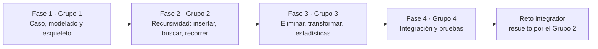

# Trabajo colaborativo de la APE 3

La APE 3 se organizó en cuatro fases. En cada una, un grupo del curso **facilitó** la clase y los demás grupos resolvieron sus actividades. Cada fase partió del código que dejó la anterior.



## Cómo se conservó la autoría

Cada carpeta de fase se importó con `git subtree`, que **conserva los commits originales con su autor y su fecha**. Para ver quién aportó en todo el repositorio:

```bash
git shortlog -sn --all
```

Para ver el historial completo con ramas y fusiones:

```bash
git log --graph --format="%h %an - %s"
```

El repositorio reúne **más de 145 commits de 20 cuentas** de los cuatro grupos.

## Resumen por fase

| Fase | Fecha | Grupo que facilita | Repositorio original | Commits | Pull requests |
|---|---|---|---|---|---|
| 1 · Modelado | Lun 12/10/2026 | Grupo 1 | Entregado como código base y subido al repositorio del curso | 1 | — |
| 2 · Recursividad | Lun 19/10/2026 | Grupo 2 | [APE3-Arboles-Grupo2](https://github.com/Damienq7w/APE3-Arboles-Grupo2) | 76 | 12 |
| 3 · Actualización | Jue 22/10/2026 | Grupo 3 | [APE3_ArbolGeneral_ABB_Grupo3](https://github.com/ElJoss09/APE3_ArbolGeneral_ABB_Grupo3) | 6 | — |
| 4 · Integración | Jue 05/11/2026 | Grupo 4 | [APE3-Grupo4-Integracion-y-pruebas-](https://github.com/shirleymikaela2/APE3-Grupo4-Integracion-y-pruebas-) | 25 | 10 |
| 4 · Reto integrador | 05–08/11/2026 | Grupo 2 (resuelve) | [Estructura_Datos_Reto_Grupo4](https://github.com/Damienq7w/Estructura_Datos_Reto_Grupo4) | 32 | 7 |

## Integrantes de cada grupo

| Grupo | Facultad del design challenge | Integrantes |
|---|---|---|
| 1 | FISEI | Altamirano Segovia Jullisa Brigitte, Chico Yunda Juan Carlos, Llamuca Abrajan Andrés Joel, Romo Núñez Joseph Alejandro, Torosina Armendariz Jeremy Alejandro, Tuza Quinatoa Edith Noemi |
| 2 | FCS | Cunalata Mendoza Damian Alexander, Chalco Tasna Kenneth Mateo, Camacho Monta Josue Jampier, Tisalema Guashco Darwin Joel, Tacuri Santillan Mónica Sara, Silva Camuendo Luis Alexander |
| 3 | FICM | Villacres Lopez Walter Fernando, Guamanquispe Guaman Edwin David, Ortiz Yaucan Everly Oseas, Sierra Mera Jose Ernesto, Guanoquiza Aguaguiña Justin Alexander |
| 4 | FCHE | Caguana Quishpe Lenin Josue, Oto Cundulle Cristopher Raúl, Moyota Chávez Kleber Andrés, Yanchatipan Moreta Shirley Micaela, Maigua Shigui Lenin Alexander, Villacis Jimenez Héctor Geovanny |

## Forma de trabajo del Grupo 2

- **Una rama por integrante** y **pull request** hacia `main`. Damian revisa e integra.
- **Responsables por operación** en la Fase 2 y **un solo responsable por clase** en el reto de la Fase 4, para que cada commit muestre el aporte de su autor.
- Cada responsable documenta su parte (diagramas de flujo y de secuencia en la Fase 2; `docs/misiones/` en el reto). Jampier mantiene el README y la documentación general.
- Antes de fusionar se compila el proyecto y se comprueban los resultados esperados.

### Aportes del Grupo 2 en cada fase

| Integrante | Cuenta de GitHub | Fase 2 (facilitada por el Grupo 2) | Fase 4 (reto integrador) |
|---|---|---|---|
| Damian Cunalata | `Damienq7w` | A1 y A2 (agregar y buscar unidades); integración de las ramas | `ArbolOrganizacional`, `RutaJerarquica`, `Contexto`, `Main`, `RetoIntegrador`, `RetoMision1` (Misiones 1 y 6) |
| Mónica Tacuri | `tacurisantillanmonicasara-dot`, `Sara Tacuri` | A4 `contarHojas`; estación E4 (caza del error); Padlet de la Fase 2 | `NodoUnidad`, `NodoBinario`, `EliminadorUnidades`, `TransformadorBinario`, `RetoMision2` (Misión 2) |
| Kenneth Chalco | `KEN3DYY` | A4 `altura`; B1 y B2 (insertar y buscar en el ABB); estación E1 | `Estudiante`, `UnidadAcademica`, `TipoUnidad`, `TrasladoEstudiantes`, `RetoMision3` (Misión 3) |
| Luis Silva | `luuissilva` | A4 grado y nivel; B4 y B5 (modificar y eliminar); estación E3 | `NodoEstudiante`, `Reporte`, `RetoMision4` (Misión 4) |
| Darwin Tisalema | `Joel03032007` | A3 (mostrar jerarquía); B3 (recorridos y trazas, opción 14); estación E2 | `TipoRecorrido`, `ArbolEstudiantes`, `RetoMision5` (Misión 5) |
| Josue Jampier Camacho | `jampiercamacho94-cloud` | README, índices, casos de prueba, decisiones y facilitación | README, decisiones, evidencias y salida del reto |

En la **Fase 3**, facilitada por el Grupo 3, el Grupo 2 resolvió en conjunto el reto y las preguntas guía publicadas en el Padlet de la fase (modificar el 45, eliminar el 30, trazas y casos límite). Las respuestas están en el informe.

### Commits por cuenta en este repositorio

| Cuenta | Grupo | Commits |
|---|---|---|
| Damienq7w | 2 | 38 |
| jampiercamacho94-cloud | 2 | 26 |
| Joel03032007 | 2 | 14 |
| luuissilva | 2 | 13 |
| KEN3DYY | 2 | 10 |
| tacurisantillanmonicasara-dot / Sara Tacuri | 2 | 14 |
| Shirley Micaela / shirleymikaela2 | 4 | 9 |
| geovanny1235 | 4 | 4 |
| X-virus27 | 4 | 4 |
| kleberGit7 / Kleber | 4 | 5 |
| Lenin / Lenin-21 / Lenin Josue Caguana Quishpe | 4 | 3 |
| ElJoss09 | 3 | 2 |
| Edwin Guamanquispe | 3 | 2 |
| Jose Sierra | 3 | 1 |
| Jose Mera | 3 | 1 |

Los commits de integración de este repositorio (importación de cada fase, versión final en `src/` y documentación) los hizo Damian como integrador del Grupo 2.

## Pull requests fusionados

**Fase 2 (APE3-Arboles-Grupo2):** PR #1 a #14 desde las ramas `Damian_Cunalata` (#1), `Rama-Joel` (#2, #9), `Mateo-Chalco` (#4), `Rama-Luis-Silva` (#6, #11, #12), `Sara-Tacuri` (#7, #10) y `rama---Josue` (#8, #13, #14).

**Fase 4, Grupo 4 (APE3-Grupo4-Integracion-y-pruebas-):** PR #1 a #10, ramas `feat/shirley`, `feat/andres`, `feat/cris`, `feat/hector`, `feat/josue` y `feat/lenin`.

**Fase 4, reto del Grupo 2 (Estructura_Datos_Reto_Grupo4):**

| PR | Rama | Integrante | Aporte |
|---|---|---|---|
| #1 | `Damian_Cunalata` | Damian | Árbol organizacional, ruta jerárquica y opción 8 |
| #2 | `Rama-Joel` | Darwin | ABB de estudiantes y `contarAprobados` |
| #3 | `Mateo-Chalco` | Kenneth | Modelo y traslado seguro |
| #4 | `Luis-Silva` | Luis | Reporte y modificación segura |
| #5 y #6 | `rama-Josue` | Jampier | Documentación y evidencias |
| #7 | `Monica_Tacuri` | Mónica | Eliminación protegida y transformación binaria |
