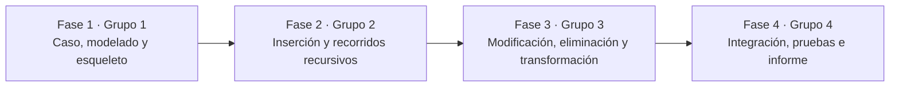

# Trabajo colaborativo de la APE 3

Según la planificación de Estructura de Datos, la APE 3 se organizó en cuatro fases de 2 horas. En cada una, un grupo del curso **facilitó** la clase y los demás grupos resolvieron sus actividades. Cada fase partió del código que dejó la anterior.



## Cómo se conservó la autoría

Cada carpeta de fase se importó con `git subtree`, que **conserva los commits originales con su autor y su fecha**. Para ver quién aportó:

```bash
git shortlog -sn --all
```

Para ver el historial completo con ramas y fusiones:

```bash
git log --graph --format="%h %an - %s"
```

## Resumen por fase

| Fase | Fecha | Grupo que facilita | Repositorio original | Commits | Pull requests |
|---|---|---|---|---|---|
| 1 · Modelado | 12/10/2026 | Grupo 1 | [APE3-Arboles](https://github.com/juanchicoyunda1234/APE3-Arboles) | 25 | — |
| 2 · Recursividad | 19/10/2026 | Grupo 2 | [APE3-Arboles-Grupo2](https://github.com/Damienq7w/APE3-Arboles-Grupo2) | 76 | 12 |
| 3 · Actualización | 22/10/2026 | Grupo 3 | [APE3_ArbolGeneral_ABB_Grupo3](https://github.com/ElJoss09/APE3_ArbolGeneral_ABB_Grupo3) | 6 | — |
| 4 · Integración | 05/11/2026 | Grupo 4 | [APE3-Grupo4-Integracion-y-pruebas-](https://github.com/shirleymikaela2/APE3-Grupo4-Integracion-y-pruebas-) | 25 | 10 |

## Integrantes de cada grupo

| Grupo | Facultad del design challenge | Integrantes |
|---|---|---|
| 1 | FISEI | Altamirano Segovia Jullisa Brigitte, Chico Yunda Juan Carlos, Llamuca Abrajan Andrés Joel, Romo Núñez Joseph Alejandro, Torosina Armendariz Jeremy Alejandro, Tuza Quinatoa Edith Noemi |
| 2 | FCS | Cunalata Mendoza Damian Alexander, Chalco Tasna Kenneth Mateo, Camacho Monta Josue Jampier, Tisalema Guashco Darwin Joel, Tacuri Santillan Mónica Sara, Silva Camuendo Luis Alexander |
| 3 | FICM | Villacres Lopez Walter Fernando, Guamanquispe Guaman Edwin David, Ortiz Yaucan Everly Oseas, Sierra Mera Jose Ernesto, Guanoquiza Aguaguiña Justin Alexander |
| 4 | FCHE | Caguana Quishpe Lenin Josue, Oto Cundulle Cristopher Raúl, Moyota Chávez Kleber Andrés, Yanchatipan Moreta Shirley Micaela, Maigua Shigui Lenin Alexander, Villacis Jimenez Héctor Geovanny |

## Forma de trabajo del Grupo 2

- **Una rama por integrante** y **pull request** hacia `main`. Damian revisa e integra.
- **Responsables por operación** en la Fase 2, para que cada commit muestre el aporte de su autor.
- Cada responsable documenta su parte; Jampier mantiene el README y la documentación general.
- Antes de fusionar se compila el proyecto y se comprueban los resultados esperados.

### Aportes del Grupo 2

| Integrante | Cuenta de GitHub | Fase 2 (facilitada por el Grupo 2) |
|---|---|---|
| Damian Cunalata | `Damienq7w` | A1 y A2 (agregar y buscar unidades); integración de las ramas |
| Mónica Tacuri | `tacurisantillanmonicasara-dot`, `Sara Tacuri` | A4 `contarHojas`; estación E4 (caza del error); Padlet de la Fase 2 |
| Kenneth Chalco | `KEN3DYY` | A4 `altura`; B1 y B2 (insertar y buscar en el ABB); estación E1 |
| Luis Silva | `luuissilva` | A4 grado y nivel; B4 y B5 (modificar y eliminar); estación E3 |
| Darwin Tisalema | `Joel03032007` | A3 (mostrar jerarquía); B3 (recorridos y trazas, opción 14); estación E2 |
| Josue Jampier Camacho | `jampiercamacho94-cloud` | README, índices, casos de prueba, decisiones y facilitación |

En la **Fase 3**, facilitada por el Grupo 3, el Grupo 2 resolvió en conjunto las preguntas guía publicadas en el Padlet de la fase (modificar el 45, eliminar el 30, trazas y casos límite). Las respuestas están en el informe.

En la **Fase 4**, el Grupo 2 integró las cuatro fases en este repositorio y comprobó el sistema terminado con pruebas normales y de casos límite.

## Pull requests de las fases

**Fase 2 (APE3-Arboles-Grupo2):** PR #1 a #14 desde las ramas `Damian_Cunalata` (#1), `Rama-Joel` (#2, #9), `Mateo-Chalco` (#4), `Rama-Luis-Silva` (#6, #11, #12), `Sara-Tacuri` (#7, #10) y `rama---Josue` (#8, #13, #14).

**Fase 4 (APE3-Grupo4-Integracion-y-pruebas-):** PR #1 a #10, ramas `feat/shirley`, `feat/andres`, `feat/cris`, `feat/hector`, `feat/josue` y `feat/lenin`.
