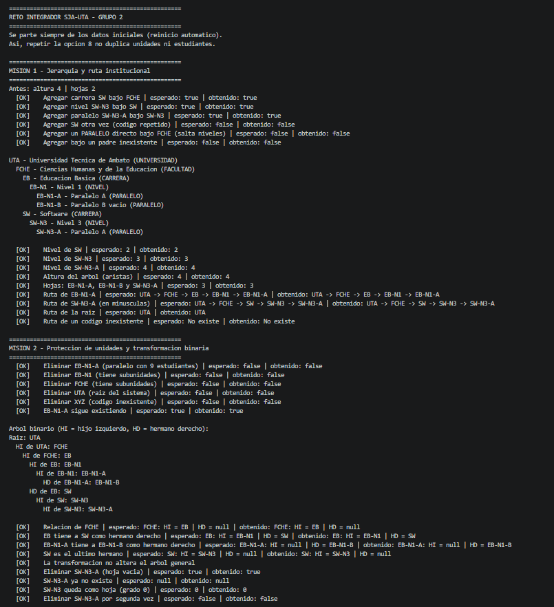
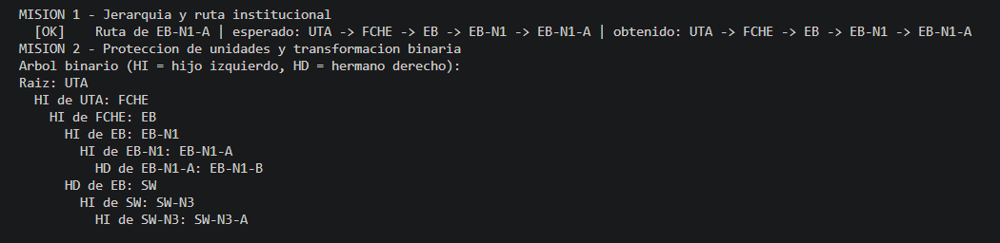
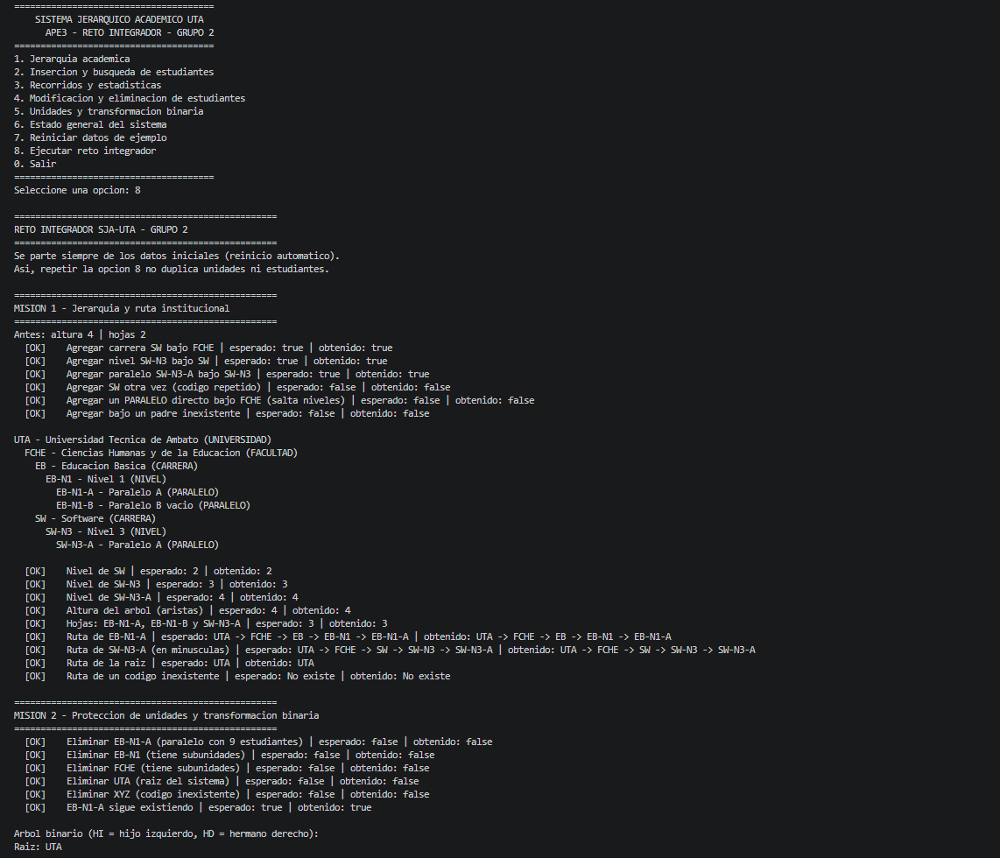
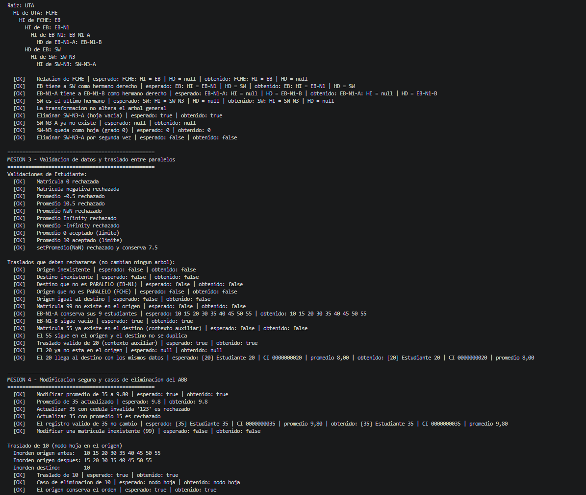
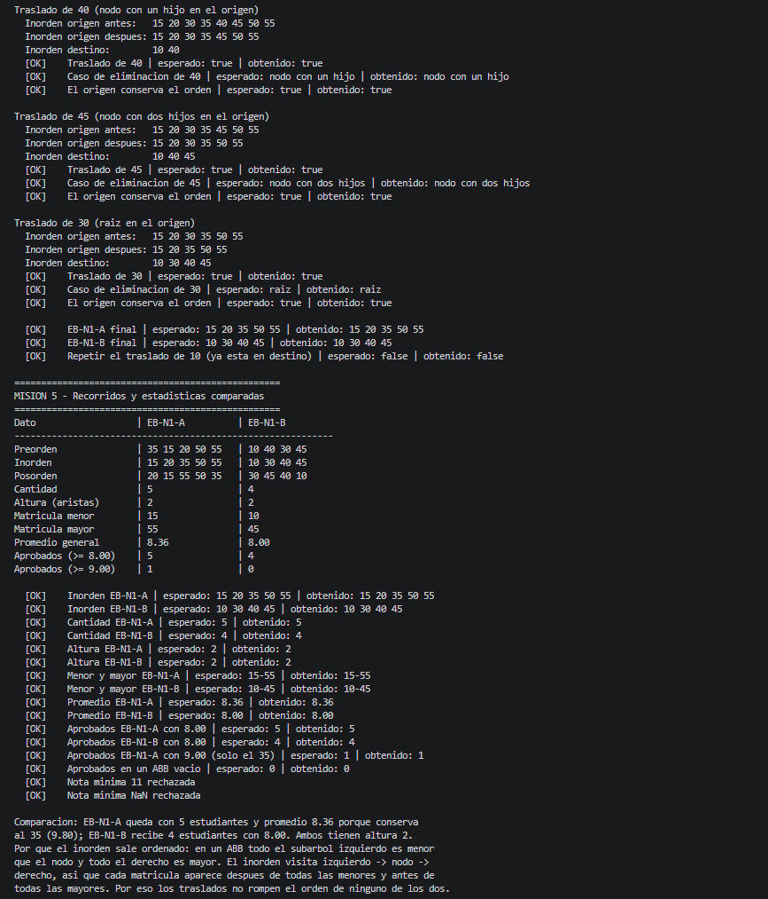
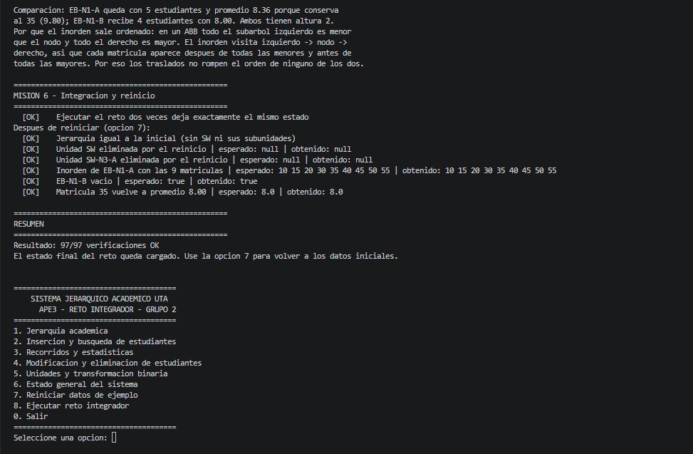
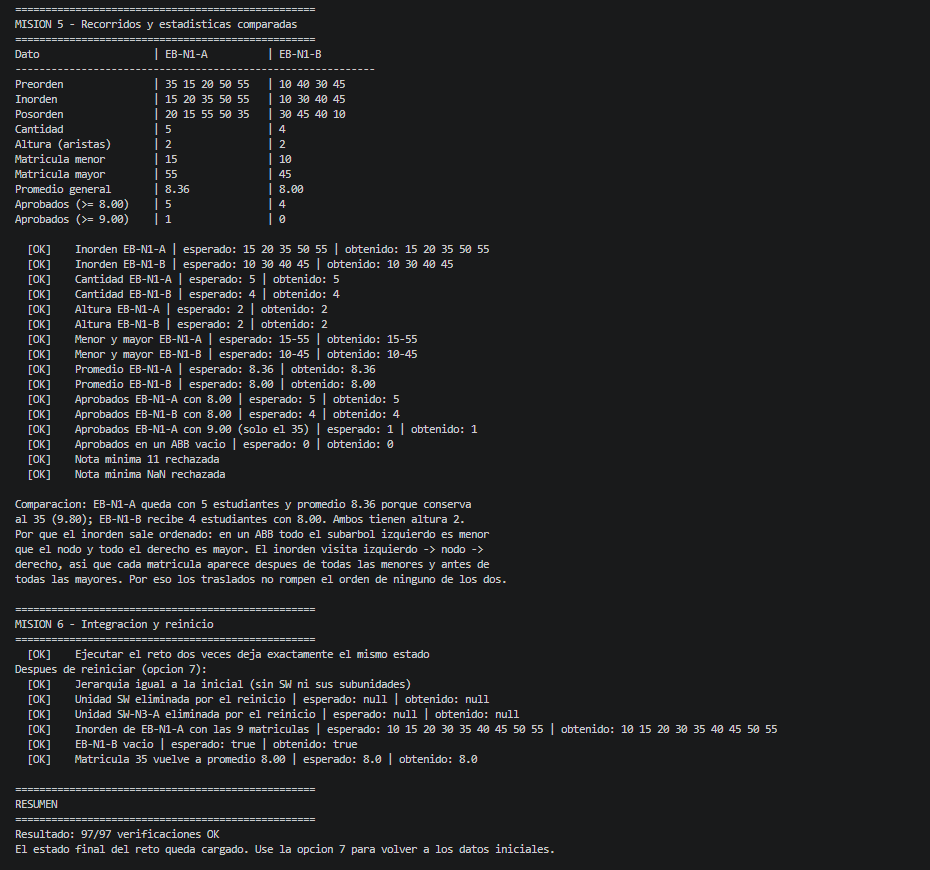
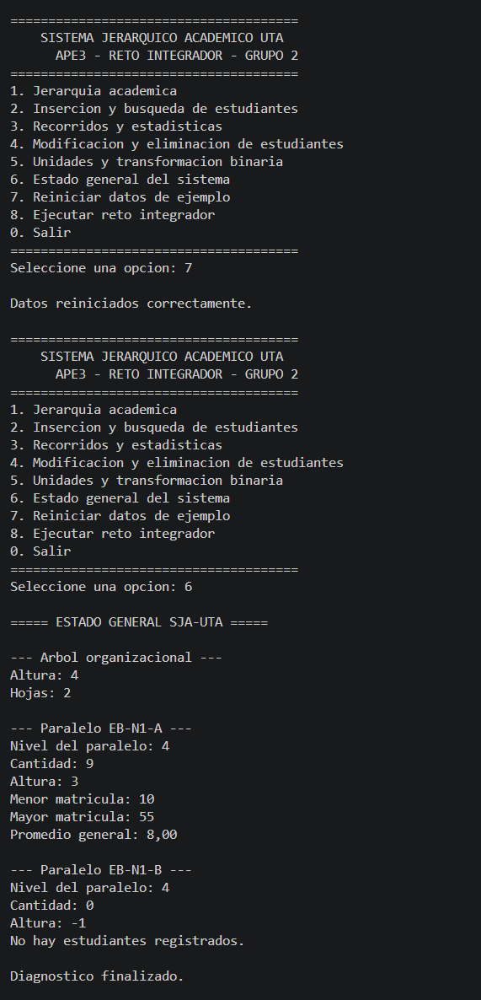
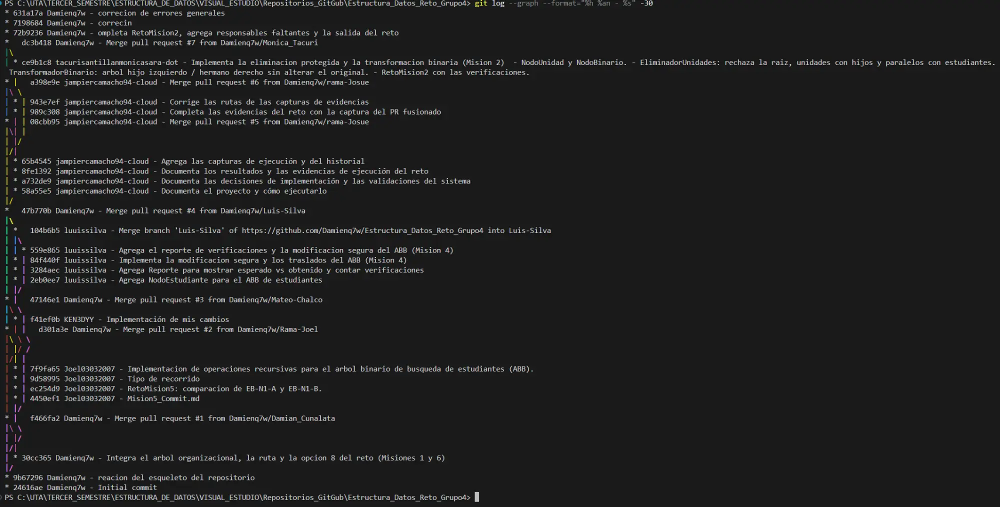
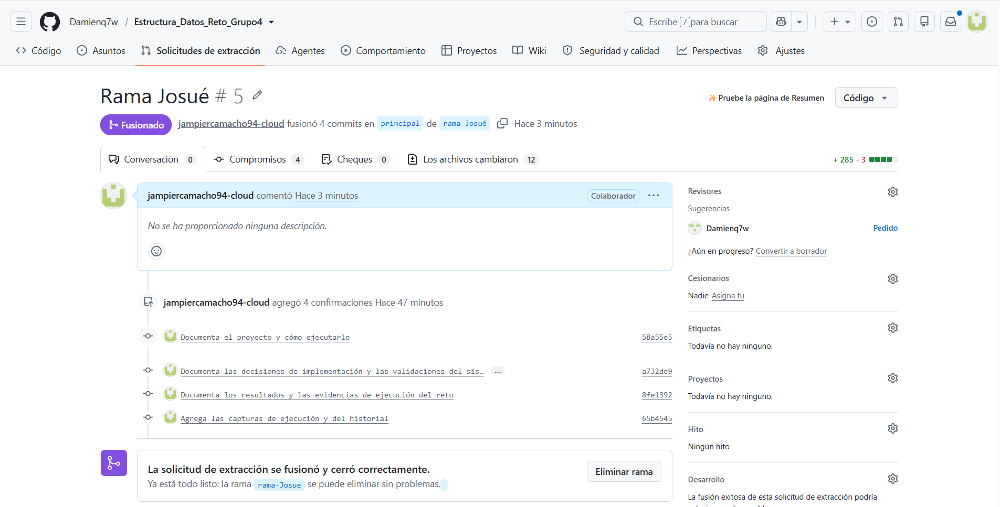

# Evidencias de ejecución

Responsable de documentación — Jampier Camacho.

## Versión utilizada

Las pruebas se realizaron con Java 21 en una copia local del proyecto.

Se utilizó `main` en el commit `47b770b`, integrado con la rama `origin/Monica_Tacuri` en el commit `ce9b1c8`.

El archivo `RetoMision2.java` de esa rama contenía únicamente la declaración de la clase. Para completar la ejecución se utilizó su implementación del commit 4 del paquete de referencia.

Los resultados de este documento corresponden a esa copia local integrada.

## Resultado general

Se ejecutó el siguiente comando.

```bash
java -cp out app.RetoIntegrador
```

El programa terminó con este resultado.

```text
Resultado: 97/97 verificaciones OK
```

La salida completa se encuentra en [salida_reto.txt](salida_reto.txt).

## Resultados por misión

| Misión | Verificaciones correctas | Resultado principal                                                                 |
| ------ | ------------------------ | ----------------------------------------------------------------------------------- |
| 1      | 15                       | Se verificaron las rutas, los niveles, la altura y las hojas de la organización     |
| 2      | 15                       | Se protegieron las unidades ocupadas y se comprobó la transformación binaria        |
| 3      | 23                       | Se rechazaron datos inválidos y traslados que incumplían las condiciones            |
| 4      | 21                       | Se verificaron la modificación y los cuatro casos de eliminación mediante traslados |
| 5      | 16                       | Se comprobaron los recorridos, las cantidades, los promedios y los aprobados        |
| 6      | 7                        | Se comprobó la repetición del reto y la recuperación del estado inicial             |
| Total  | 97                       | Todas las verificaciones fueron correctas                                           |

## Ruta institucional

La ruta obtenida para EB-N1-A fue la siguiente.

```text
UTA -> FCHE -> EB -> EB-N1 -> EB-N1-A
```

## Protección de unidades

| Unidad  | Condición                         | Resultado de eliminar |
| ------- | --------------------------------- | --------------------- |
| EB-N1-A | Paralelo con estudiantes          | false                 |
| EB-N1   | Unidad con subunidades            | false                 |
| FCHE    | Unidad con subunidades            | false                 |
| UTA     | Raíz de la organización           | false                 |
| XYZ     | Código inexistente                | false                 |
| SW-N3-A | Hoja vacía creada durante el reto | true                  |

## Traslados de estudiantes

Se trasladaron las matrículas 10, 40, 45 y 30 desde EB-N1-A hacia EB-N1-B.

| Matrícula | Caso de eliminación | Inorden del origen antes   | Inorden del origen después |
| --------- | ------------------- | -------------------------- | -------------------------- |
| 10        | Hoja                | 10 15 20 30 35 40 45 50 55 | 15 20 30 35 40 45 50 55    |
| 40        | Un hijo             | 15 20 30 35 40 45 50 55    | 15 20 30 35 45 50 55       |
| 45        | Dos hijos           | 15 20 30 35 45 50 55       | 15 20 30 35 50 55          |
| 30        | Raíz                | 15 20 30 35 50 55          | 15 20 35 50 55             |

## Comparación final

| Dato                           | EB-N1-A        | EB-N1-B     |
| ------------------------------ | -------------- | ----------- |
| Inorden                        | 15 20 35 50 55 | 10 30 40 45 |
| Cantidad                       | 5              | 4           |
| Altura                         | 2              | 2           |
| Matrícula menor                | 15             | 10          |
| Matrícula mayor                | 55             | 45          |
| Promedio general               | 8.36           | 8.00        |
| Aprobados con nota mínima 8.00 | 5              | 4           |

## Pruebas mediante el menú

Se ejecutó `java -cp out app.Main` y se introdujo la siguiente secuencia.

| Paso | Opción                             | Resultado observado                                        |
| ---- | ---------------------------------- | ---------------------------------------------------------- |
| 1    | 8                                  | 97/97 verificaciones correctas                             |
| 2    | 8 nuevamente                       | Se obtuvo el mismo resultado                               |
| 3    | 6                                  | EB-N1-A mostró cinco estudiantes y promedio 8.36           |
| 4    | 7                                  | Se confirmó el reinicio de los datos                       |
| 5    | 6                                  | EB-N1-A mostró nueve estudiantes, altura 3 y promedio 8.00 |
| 6    | 1, ingresando EB-N1-A              | Se mostró la ruta institucional                            |
| 7    | 5, subopción 2, ingresando EB-N1-A | Se rechazó eliminar el paralelo con estudiantes            |

## Capturas

### Figura 1. Compilación del proyecto con Java 21



### Figura 2. Ruta institucional y transformación binaria



### Figura 3. Recorridos antes y después de los traslados









### Figura 4. Comparación final y resultado del reto



### Figura 5. Recuperación del estado inicial



### Figura 6. Historial local de commits



### Figura 7. Pull request #5 fusionado en main


