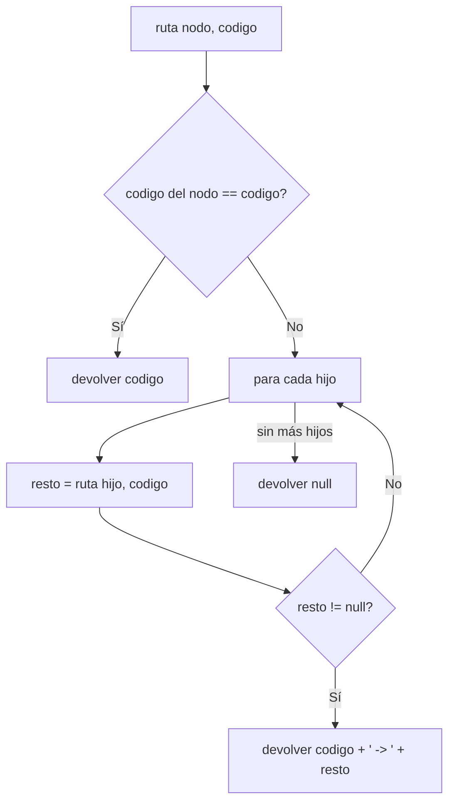

# Misión 1 — Jerarquía y ruta institucional

> **Responsable:** Damián Cunalata · **Archivos:** `RutaJerarquica.java`, `RetoMision1.java` (y la llamada en `ArbolOrganizacional.java`)

## Qué se hizo

1. Se registran, en este orden, la carrera `SW` bajo `FCHE`, el nivel `SW-N3` bajo `SW` y el paralelo `SW-N3-A` bajo `SW-N3`. `agregar` respeta UNIVERSIDAD → FACULTAD → CARRERA → NIVEL → PARALELO.
2. Se comprueba que se rechacen un código repetido, un salto de jerarquía (un PARALELO directo bajo FCHE) y un padre inexistente.
3. Se implementa `RutaJerarquica.obtener(raiz, codigo)`, que es recursivo. `ArbolOrganizacional.obtenerRutaJerarquica(String codigo)` conserva la firma del enunciado y lo llama.

## Cómo funciona la ruta

- **Caso base:** el nodo actual es la unidad buscada, así que devuelve su código.
- **Caso recursivo:** busca en cada hijo. Si un hijo devuelve una ruta, antepone el código actual y `" -> "`.
- Si ningún hijo la contiene, devuelve `null`, y el método público lo convierte en `"No existe"`.

Complejidad: O(N) en tiempo, porque en el peor caso recorre todas las unidades, y O(H) de pila, donde H es la altura del árbol.

## Resultados esperados

| Consulta | Esperado |
|---|---|
| Nivel de SW / SW-N3 / SW-N3-A | 2 / 3 / 4 |
| Altura del árbol | 4 aristas (no cambia: SW-N3-A está al mismo nivel que EB-N1-A) |
| Hojas | 3 (EB-N1-A, EB-N1-B y SW-N3-A) |
| Ruta de EB-N1-A | `UTA -> FCHE -> EB -> EB-N1 -> EB-N1-A` |
| Ruta de XYZ | `No existe` |

La opción 1 del menú también muestra la ruta de la unidad consultada.
