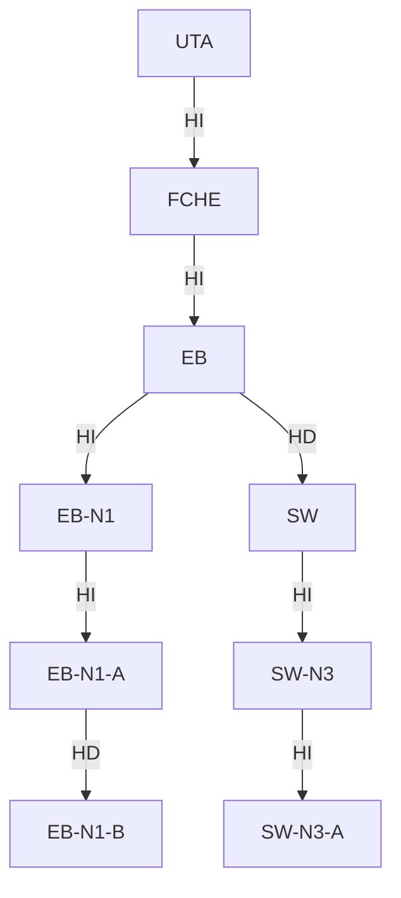

# Misión 2 — Protección de unidades y transformación binaria

> **Responsable:** Mónica Tacuri · **Archivos:** `EliminadorUnidades.java`, `TransformadorBinario.java`, `NodoBinario.java`, `NodoUnidad.java`, `RetoMision2.java`

## Eliminación reforzada

`eliminar(String codigo)` solo borra una **hoja vacía**. Devuelve `false` cuando:

| Caso | Ejemplo |
|---|---|
| El código no existe | `XYZ` |
| Es la raíz del sistema | `UTA` |
| Tiene subunidades | `FCHE`, `EB-N1` |
| Es un paralelo con estudiantes | `EB-N1-A` (9 estudiantes) |

Cambios respecto al código base:

- **Ya no se puede borrar la raíz.** Antes, si la UTA quedaba como hoja, se podía eliminar y el sistema se quedaba sin árbol.
- **Una sola búsqueda.** La versión base buscaba la unidad, la validaba y la volvía a buscar. Ahora un único recorrido recursivo encuentra al padre y decide ahí mismo, porque los códigos son únicos.
- **La regla vive en `EliminadorUnidades.puedeEliminar`, en la capa de negocio.** El menú no es la única protección.
- **Clase propia:** `ArbolOrganizacional.eliminar` conserva su firma y solo llama a `EliminadorUnidades.eliminar(raiz, codigo)`.

## Transformación hijo izquierdo / hermano derecho

El código base solo imprimía texto. Ahora `TransformadorBinario.construir(raiz)`, que `ArbolOrganizacional.construirBinario()` llama, crea un **árbol binario nuevo** con nodos `NodoBinario`:

- `hijoIzquierdo` es el primer hijo de la unidad.
- `hermanoDerecho` es el siguiente hijo del mismo padre.

Los nodos binarios son nuevos y solo comparten la `UnidadAcademica`, así que **el árbol general no se modifica**. El reto lo comprueba comparando `mostrarJerarquia()` antes y después.

`relacionBinaria(codigo)` resume los enlaces de un nodo. Por ejemplo: `EB: HI = EB-N1 | HD = SW` y `EB-N1-A: HI = null | HD = EB-N1-B`.

## Eliminación permitida

Después de la transformación se elimina `SW-N3-A`, que es una hoja vacía. Devuelve `true`, `SW-N3` queda con grado 0 y un segundo intento devuelve `false`.
