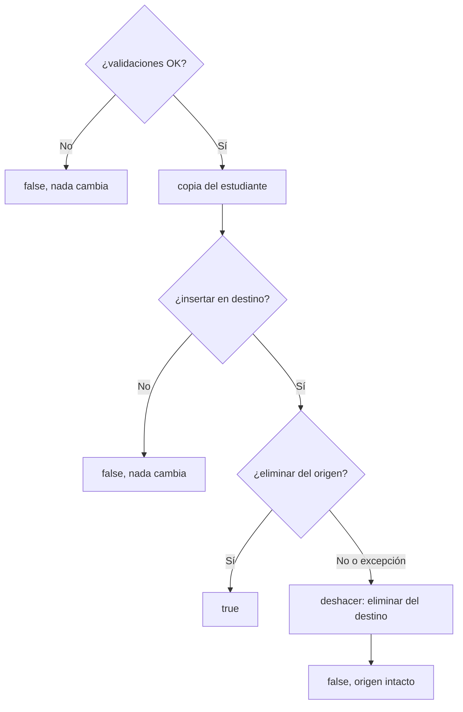

# Misión 3 — Validación de datos y traslado entre paralelos

> **Responsable:** Kenneth Chalco · **Archivos:** `TrasladoEstudiantes.java`, `Estudiante.java`, `RetoMision3.java`

## Validaciones de `Estudiante`

El modelo ya validaba en el constructor y en los setters. Se comprobó cada caso:

| Entrada | Resultado |
|---|---|
| Matrícula 0 o negativa | `IllegalArgumentException` |
| Promedio −0.5 o 10.5 | `IllegalArgumentException` |
| Promedio `NaN`, `Infinity`, `-Infinity` | `IllegalArgumentException` (`Double.isFinite`) |
| Promedio 0 y 10 | Aceptados (son los límites) |
| `setPromedio(NaN)` sobre un estudiante con 7.5 | Rechazado; conserva 7.5 |

`NaN` necesita `Double.isFinite`: cualquier comparación con `NaN` da `false`, así que `NaN < 0 || NaN > 10` lo dejaría pasar.

## `trasladarEstudiante(codOrigen, codDestino, matricula)`

`ArbolOrganizacional.trasladarEstudiante` conserva la firma del enunciado: busca los dos paralelos y llama a `TrasladoEstudiantes.trasladar(origen, destino, matricula)`, que hace todo el trabajo.

Se acepta solo si:

1. Origen y destino existen, son distintos y ambos son de tipo `PARALELO`.
2. La matrícula existe en el origen.
3. La matrícula no existe en el destino.

**Orden seguro, para no perder información:**

- **Primero se inserta en el destino.** Si algo falla después, el estudiante sigue existiendo en algún lugar.
- **Se inserta una copia** con los mismos datos. Así los dos paralelos nunca comparten el mismo objeto.
- **Recuperación:** si eliminar del origen devuelve `false` o lanza una excepción, se quita la copia del destino. El estado vuelve a ser el anterior.

## Pruebas del reto

Se rechazan: origen o destino inexistente, destino `EB-N1` (es un NIVEL), origen `FCHE`, origen igual al destino y la matrícula 99. Después de esos intentos, EB-N1-A conserva sus 9 estudiantes.

El caso «duplicado en destino» y un traslado válido se prueban en un contexto auxiliar, para no adelantar los traslados de la Misión 4.
