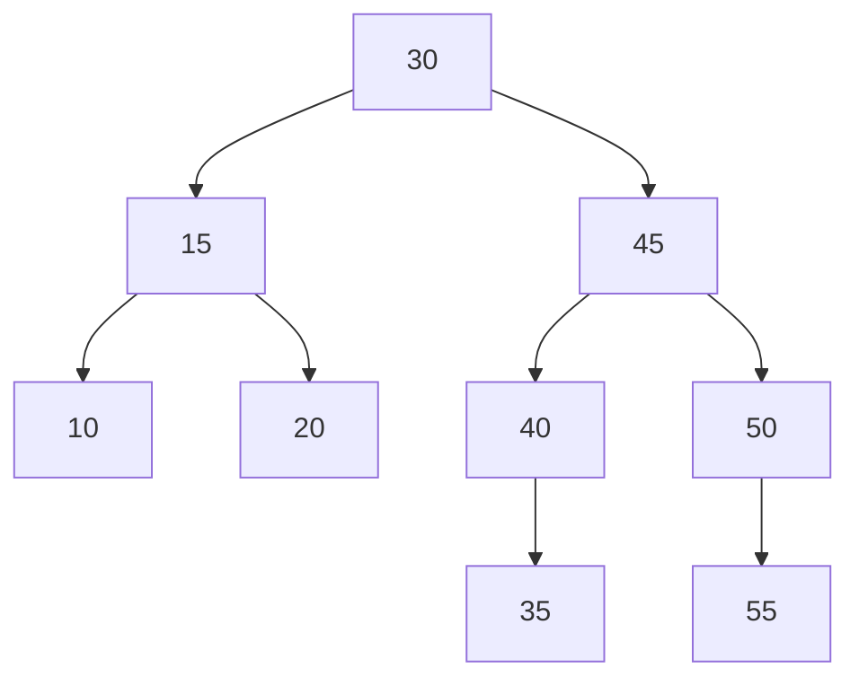
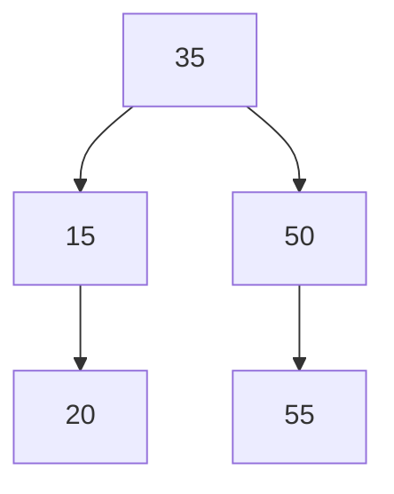

# Misión 4 — Modificación segura y casos de eliminación del ABB

> **Responsable:** Luis Silva · **Archivos:** `RetoMision4.java`, `NodoEstudiante.java`, `Reporte.java`

## Modificación segura

| Paso | Resultado |
|---|---|
| Promedio de la matrícula 35 → 9.80 | `true` |
| Intento con cédula `123` | `IllegalArgumentException` |
| Intento con promedio 15 | `IllegalArgumentException` |
| Registro de 35 después de los intentos | Sigue con 9.80, su cédula y su nombre |

`modificar` valida primero con un `Estudiante` temporal y solo después aplica los setters. Si un dato es inválido, el registro real no cambia.

## Traslados y casos de eliminación en EB-N1-A

ABB inicial (inserción 30, 15, 45, 10, 20, 40, 50, 35, 55):

| Orden | Matrícula | Caso en el origen | Por qué |
|---|---|---|---|
| 1 | 10 | Nodo hoja | No tiene hijos |
| 2 | 40 | Nodo con un hijo | Solo tiene el hijo izquierdo 35 |
| 3 | 45 | Nodo con dos hijos | Tiene 35 y 50; lo reemplaza su sucesor inorden, 50 |
| 4 | 30 | Raíz | Tiene dos hijos; lo reemplaza su sucesor inorden, 35 |

El reto clasifica cada nodo **antes** de trasladarlo, imprime el inorden del origen antes y después, y verifica que siga creciente.

ABB final de EB-N1-A:

| Paralelo | Inorden final |
|---|---|
| EB-N1-A | 15 20 35 50 55 |
| EB-N1-B | 10 30 40 45 |

Repetir el traslado de 10 devuelve `false`, porque ya está en el destino.
