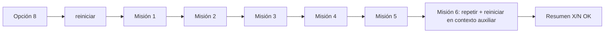

# Misión 6 — Integración y reinicio

> **Responsable:** Damián Cunalata (integrador) · **Archivos:** `Main.java`, `Contexto.java`, `RetoIntegrador.java`, `ArbolOrganizacional.java`

## Opción 8: «Ejecutar reto integrador»

`RetoIntegrador.ejecutar(c)` corre las misiones en orden y muestra cada comprobación como `[OK]` o `[FALLO]`, con el valor esperado y el obtenido en la ejecución.

Al final imprime `Resultado: X/N verificaciones OK`.

El reto también se puede correr sin menú:

```powershell
java -cp out app.RetoIntegrador
```

Si alguna verificación falla, el programa termina con código 1.

## Cómo se evita duplicar datos

- **Reinicio automático:** la opción 8 siempre empieza con `c.reiniciar()`. Por eso, ejecutarla dos o más veces produce el mismo resultado y nunca intenta agregar `SW` dos veces ni trasladar a un estudiante que ya se movió.
- **Defensa en negocio:** aunque no se reiniciara, `agregar` rechaza códigos repetidos y `trasladarEstudiante` rechaza matrículas que ya están en el destino. El reto lo comprueba en las Misiones 1 y 4.

## Opción 7: reinicio

`Contexto.reiniciar()` crea un `ArbolOrganizacional` nuevo en lugar de reparar el anterior. Así no queda ningún rastro del reto:

- Las 9 matrículas vuelven a EB-N1-A con promedio 8.00, incluida la 35.
- EB-N1-B queda vacío.
- SW, SW-N3 y SW-N3-A dejan de existir.

## Cómo se comprueba

La Misión 6 trabaja con un contexto auxiliar, para no alterar el estado que ve el usuario:

1. Corre el reto dos veces y compara el estado completo: jerarquía y preorden con los datos de cada paralelo. Debe ser idéntico.
2. Llama a `reiniciar()` y verifica la jerarquía inicial, la ausencia de SW, las 9 matrículas en EB-N1-A, EB-N1-B vacío y el promedio 8.00 de la 35.


